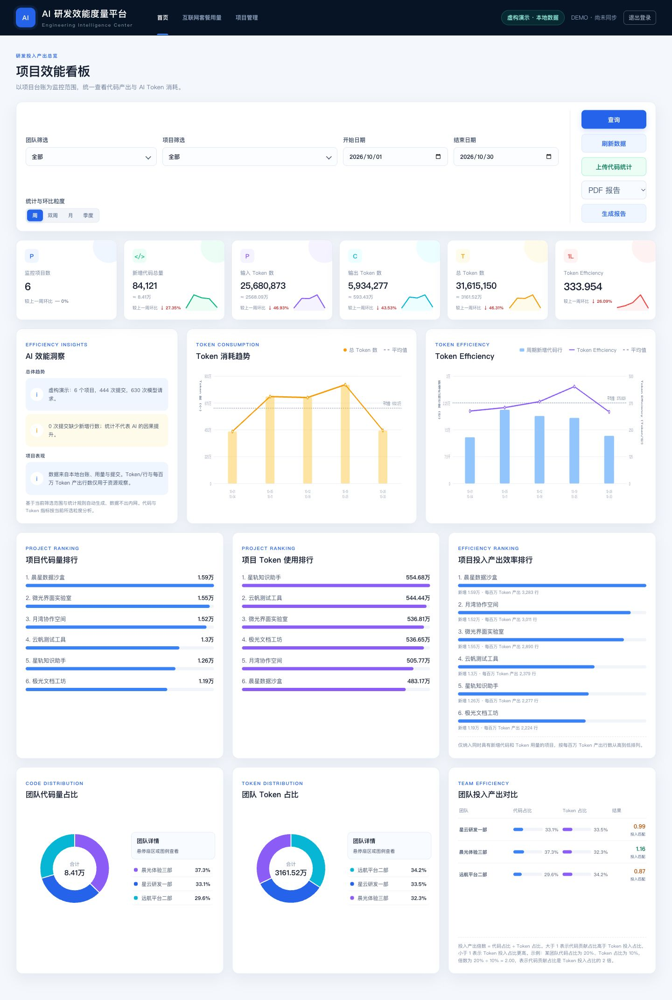

# AI 研发效能分析平台

个人求职演示项目：后端基于通用需求独立实现；按用户明确要求，保留原可运行成果的前端代码。使用 FastAPI、SQLite 和原生 JavaScript，将 AI 用量、代码提交、项目台账放在同一个分析界面。默认无需密钥、无需外部服务即可运行。

**内置公司、部门、成员、项目、仓库地址和统计数据全部虚构。后端、配置、文档和 Git 历史均为新建。**

## 功能

- **项目效能 Dashboard**：团队、项目、日期筛选，日/周/月聚合；六项指标卡、Token 趋势、代码量与 Token 排行、团队分布、预算与工期分析。
- **LiteLLM Token 分析**：导入标准 SpendLogs JSON，统计输入/输出 Token、请求数、模型用量与 USD 费用；按 request_id 去重。
- **Gitee 提交统计**：默认使用虚构提交；可选按需采集公开仓库 API，支持分页、范围限制和重复提交去重。
- **Excel 项目台账**：下载虚构 `.xlsx` 模板、整批校验导入、项目编辑；校验失败回滚，按项目 ID 更新。
- **保留原前端**：原首页、项目管理、项目详情、套餐页和登录页代码不变；后端实现兼容接口，返回虚构数据。原图表使用 SVG。
- **独立数据工作区**：新增 `/workspace` 处理 Excel、LiteLLM 导入、Gitee 采集、模型用量与预算工期分析，无需改动原首页。
- **报告导出**：原按钮可导出简要 PDF / Word 报告；PDF 使用项目数字 ID，Word 支持中文名称，无复制字体或报告模板。
- **公开前检查**：依赖许可证清单、安全审计、可重复执行的敏感信息扫描脚本和 CI。

根据用户最终要求，`static/` 下原有 6 个前端文件逐字节保留；不改页面布局、样式、脚本或交互。它们本身不含企业数据或实际仓库地址。原界面按至少 1180px 桌面宽度设计，窄屏会横向滚动。新增数据工作区在独立子目录，原界面文件没有被修改。



## 技术栈与结构

- Python 3.12+ / FastAPI / Uvicorn / Pydantic
- SQLite（标准库）、HTTPX、openpyxl + defusedxml
- HTML / CSS / 原生 JavaScript / SVG（保留界面）及 Canvas（独立工作区）
- pytest / FastAPI TestClient / pip-licenses / pip-audit

```text
app/              配置、数据存储、虚构数据、导入校验、聚合、公开 API 适配
static/           逐字节保留的 6 个原前端文件
static/workspace/ 独立实现的数据导入分析工作区
tests/            指标、导入、安全边界、模拟上游 API 测试
scripts/          敏感信息扫描
docs/             架构、验收、许可证和安全审计
examples/         虚构 LiteLLM 日志
runtime/          首次启动自动生成；不进入 Git
```

## 安装与启动

macOS / Linux，进入本项目目录执行：

```bash
python3 -m venv .venv
source .venv/bin/activate
python -m pip install -r requirements.txt
cp .env.example .env
python -m uvicorn app.main:app --host 127.0.0.1 --port 8000
```

打开 [原界面演示首页](http://127.0.0.1:8000)，或 [数据导入与分析工作区](http://127.0.0.1:8000/workspace)。Windows 将环境激活命令替换为 `.venv\Scripts\activate`，其余命令相同。安装依赖需访问 PyPI；安装后默认演示运行不需网络。

首次启动自动创建 `runtime/dashboard.sqlite3`，填充固定种子的虚构数据。重复启动不会重复填充。若需重置，先停止服务，再删除**本项目** `runtime/` 目录内的数据库及其 `-wal`、`-shm` 文件，然后重启。

本项目是单用户本地演示，没有真实身份认证、多租户或公网部署能力。原登录页仅保留展示，接受任意非空占位值，不建立认证会话；不要输入真实账号或密码。默认仅接受本机 Host，并阻止跨站写入。不要直接绑定到公网；部署需求应另行设计认证、授权、限流、备份与隐私策略。

## 演示路线

1. 原首页保持原样，默认结束日期为浏览器当天，开始日期留空表示从演示数据最早日期统计。可手动选 **2026-10-01 至 2026-10-30** 复现单月结果。
2. 团队、项目支持多选，点击“查询”；周、双周、月、季度切换会同步更新图表和环比。
3. 点击排行中的项目，进入原项目详情页；“项目管理”支持多仓库、新增、编辑、停止、恢复、重新匹配及逻辑删除，保留历史统计。
4. 打开 `/workspace`；默认展示 2026 年 10 月。导航到“Token 分析”“代码提交”“数据导入”查看额外功能。
5. 在工作区下载虚构 Excel 台账模板并上传，修改预算、人天或新增虚构项目。先导入台账，再导入 `examples/litellm.json`；重复上传应提示跳过。
6. 原首页“上传代码统计”支持通用虚构提交 CSV，或本平台项目台账 XLSX。CSV 表头为 `project_id,sha,day,additions,author`，项目 ID 使用台账中的 P001 等；不要上传企业实际报表。
7. 原首页“刷新数据”重新读取本地快照，不自动调用真实 LiteLLM。套餐页面返回明确标注的虚构额度；模型测速禁用，不产生费用。
8. 原报告按钮导出简要 PDF / Word。登录 / 退出仅用于原界面展示，没有认证能力。

数据属于虚构的“星屿科技”，部门为“星云研发一部”“远航平台二部”“晨光体验三部”，成员使用“虚构成员甲”等占位名称。仓库均为 `https://example.com/orbit-demo/...` 下的保留示例地址，不能用于真实采集。模型别名为 demo-coder 等虚构名称。数据生成日期固定为 2026 年 9–10 月，便于稳定复现。

## 配置

配置仅从本项目 `.env` 或进程环境变量加载，不读取父目录配置；进程环境优先。安全示例见 [.env.example](.env.example)。

| 变量 | 默认值 | 用途 |
| --- | --- | --- |
| SEED_DEMO | true | 空数据库首次启动时生成虚构数据 |
| DATABASE_PATH | runtime/dashboard.sqlite3 | 本地数据库，建议始终使用忽略目录 |
| MAX_UPLOAD_BYTES | 2097152 | 单文件上限；页面仍限制为 2 MiB |
| GITEE_ENABLED | false | 是否开放按需公开 API 采集 |
| GITEE_TOKEN | 空 | 可选凭据，仅服务器读取，不返回给浏览器 |

无需配置 LiteLLM 服务或密钥。此版本采用 **LiteLLM 日志文件导入**，没有在线数据库连接、定时同步或模型调用。

如需采集 Gitee：设置 `GITEE_ENABLED=true`，重启；在项目管理登记自己有权使用的 Gitee **公开**仓库地址，然后选择项目并采集。请求固定发往官方 `https://gitee.com/api/v5`，不接受自定义主机、不跟随跳转、不使用环境代理。先验证仓库公开性；默认可不填 token，若上游策略要求认证则通过环境变量提供。每次最多 1000 条、最多 91 个 UTC 日期；触及分页上限会整批拒绝，需缩短范围。正式网络采集未作为验收依赖，测试使用 MockTransport 覆盖上游返回。

## 数据格式与统计口径

Excel 仅允许一个名为 `projects` 的工作表，表头顺序：

```text
id,name,team,owner,repository,budget,planned_days,actual_days,status
```

预算单位 USD，工期单位人天，数值均非负，状态为“进行中 / 已完成 / 已暂停”。最多 1000 行。不接受宏、公式、重复 ID、重复仓库或过大压缩包。按 ID 更新当前台账，未出现的项目保留；历史统计保留。

LiteLLM 日志示例：

```json
[
  {
    "request_id": "sample-request-001",
    "project_id": "P001",
    "startTime": "2026-10-15T08:00:00Z",
    "model": "demo-coder",
    "prompt_tokens": 12000,
    "completion_tokens": 3000,
    "total_tokens": 15000,
    "spend": 0.0168
  }
]
```

`project_id` 是本平台要求的显式关联字段，也可置于 `metadata.project_id`；导入前必须在台账登记。时间为 ISO 日期或带时区时间戳，统一转 UTC；总 Token 等于输入与输出之和；费用直接汇总 spend，不按模型报价反推。只保存白名单字段，其余密钥、提示词、用户信息和正文不入库。原始文件不持久化。request_id 全库唯一，重复记录保留先前值，不覆盖。

代码指标中，“提交次数”按项目与 SHA 去重；虚构数据提供新增行数，公开采集不推断行数，显示为“缺失”。有缺失时不计算该项目及综合的每百万 Token 产出行数。周从周一开始，双周以固定周一锚点对齐，季度按自然季度。首尾周期仅统计所选范围；环比比较筛选范围内末周期与前一周期，范围外数据不补取，可能不完整。原界面保留这些标签，需注意样本完整性。台账预算和工期为当前快照；预算使用率为**筛选期间 AI 费用 / 当前预算**，不是项目全成本。

Token 与代码产出关系只用于观察资源使用，不证明因果提升，也不适合用作个人绩效指标。代码质量、交付周期、部署频率等尚未纳入模型。

上游格式参考：[LiteLLM Spend Tracking](https://docs.litellm.ai/docs/proxy/cost_tracking)、[Gitee API 文档](https://gitee.com/api/v5/swagger)。

## 测试与审计

```bash
python -m pip install -r requirements-dev.txt
python -m pytest -q
python scripts/security_scan.py
pip-audit -r requirements.txt --no-deps --disable-pip
```

后端测试不依赖网络或外部密钥。许可证与漏洞清单见 [依赖审查](docs/DEPENDENCIES.md)，实际验收见 [测试记录](docs/TEST_RESULTS.md)，敏感信息与发布边界见 [安全审计报告](docs/SECURITY_AUDIT.md)。

`.gitignore` 排除本地配置、数据库、原始台账、日志、导出、模型权重、虚拟环境、缓存和压缩归档。它不替代人工检查。新数据建议只放在 `runtime/`，不要强制加入忽略文件。

## 本地 Git 与公开前审核

仓库为全新 Git 历史，使用虚构提交身份，无 remote；没有创建 GitHub 仓库、Push 或自动发布。CI 仅提供测试工作流，不含部署任务。本地提交身份不是原项目的提交者身份。你确认后，可在审阅内容、权属、许可证及个人署名后自行设置 remote 并上传。

审核要点：页面布局的公开使用权限、MIT 授权范围、求职描述是否准确、个人 Git 身份、截图中只有虚构数据、暂存区不含 `.env` 或数据库。发布前再次运行扫描，并人工检查 Git diff 和即将上传的文件清单。

## License

本次独立实现的内容采用 [MIT License](LICENSE)，6 个保留前端文件被明确排除。本许可不授予第三方设计、商标或原有前端资产的权利。依赖保持各自许可；见 [依赖审查](docs/DEPENDENCIES.md)。
